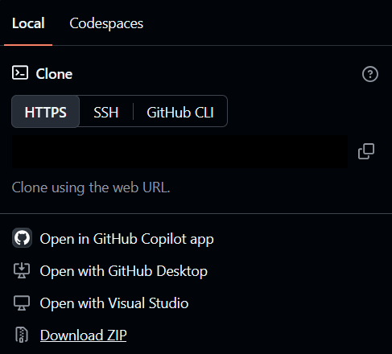
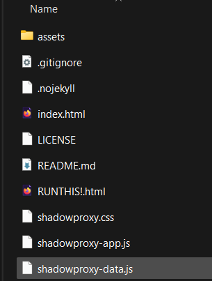

# ShadowProxy

A client-side viewer for public web pages. Public relays may fail, and page assets may load directly. Do not enter passwords or other private information.

## Download

1. Open **Code** on [this repository](https://github.com/fireax14app-source/shadowproxy).
2. Select **Download ZIP**. Wait for the download and extract it.
3. In the extracted folder, double-click **RUNTHIS!.html**. Keep `shadowproxy.css`, both JavaScript files, and `assets/` beside it.

[Visual download guide](https://fireax14app-source.github.io/shadowproxy/) · [Open online](https://fireax14app-source.github.io/shadowproxy/RUNTHIS!.html)

## License

MIT for the original project code. Destination sites and public relays have their own terms.
