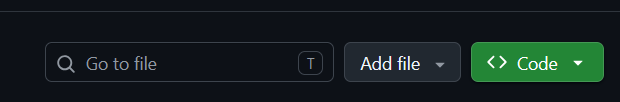

# ShadowProxy

A client-side viewer for public web pages. Public relays may fail, and page assets may load directly.

Do not enter passwords, payment details, private messages, or other sensitive information. Relay operators can see traffic sent through their services.

## Download

1. Open **Code** on [this repository](https://github.com/fireax14app-source/shadowproxy).
2. Select **Download ZIP**. Wait for the download and extract it.
3. In the extracted folder, double-click **RUNTHIS!.html**. Keep `shadowproxy.css`, `shadowproxy-data.js`, `shadowproxy-app.js`, and `assets/` beside it.

[Visual download guide](https://fireax14app-source.github.io/shadowproxy/) · [Open online](https://fireax14app-source.github.io/shadowproxy/RUNTHIS!.html)

## Troubleshooting

- Use a modern browser. ShadowProxy works with `file://` and local hosting.
- If a public relay fails, try another load mode or open the page outside ShadowProxy.
- If a page refuses to load in a frame, use **Direct** or **Open**. Some websites block frames.
- If downloads or popups are blocked, allow them for the local page or local website.
- Public relays are third-party services. They may be unavailable or rate-limited.

## License

The original project code uses the MIT License. Destination sites and public relay services have their own terms.
